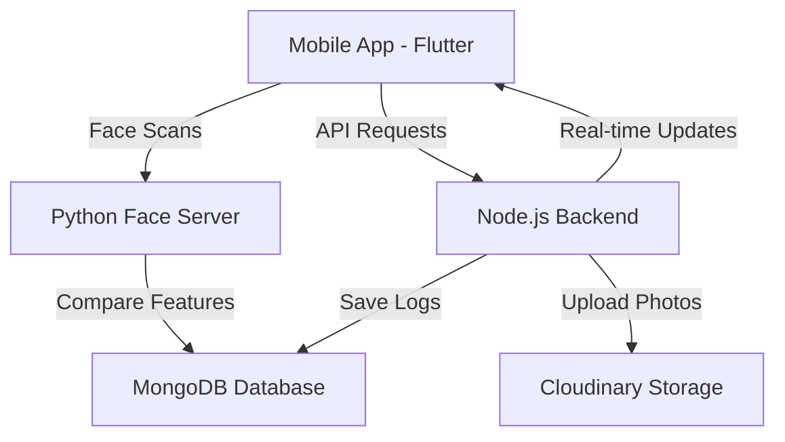

# DTR - Face Scanner & Employee Management System

A professional-grade Employee Management System featuring high-precision face recognition with DeepFace (ArcFace), real-time attendance tracking via Socket.io, and a beautiful Flutter-based mobile experience.

---

## Mobile Experience (Employees)
| Real-time Recognition | Face Registration |
|:---:|:---:|
|  |  |


### Attendance Tracking & History
Real-time monitoring of all clock-in/out activities.


## Administrative Dashboard (Web)
### Employee Registrations & Management
Explore the robust administrative panel for employee data and registration.


---

## Features
- **Face Recognition Attendance**: Advanced AI-powered facial recognition for secure and touchless clock-in and clock-out.
- **Attendance Tracking**: Real-time monitoring of employee work hours with precise clock-in and clock-out timestamps.
- **Employee Records**: Comprehensive management of employee attendance history and automated record keeping.

---

## Project Structure


---

## Setup Guide

### 1. Prerequisites
- **Node.js** (v18+)
- **Python** (v3.8+)
- **Flutter SDK**
- **MongoDB Atlas** account
- **Cloudinary** account

### 2. Backend (Node.js)
```bash
cd backend
npm install
cp .env.example .env
# Fill your credentials in .env
npm run dev
```

### 3. Face Recognition Server (Python)
```bash
cd python_face_server
python -m venv venv
.\venv\Scripts\activate  # Windows
# or
source venv/bin/activate  # Mac/Linux

pip install -r requirements.txt
cp .env.example .env
# Fill your MONGO_URI in .env
python server.py
```

### 4. Admin Frontend (React/Vite)
```bash
cd frontend
npm install
npm run dev
```

### 5. Mobile App (Flutter)
1. Update `lib/config/api_config.dart` with your **PC's Local IP Address**.
2. Run the command:
```bash
cd dtr
flutter pub get
flutter run
```

---


